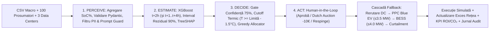

# ⚡ VoltCompute — PPC Intraday AI Agent (`t+2h` Arbitrage & Virtual Battery)

Prototip **de simulare** pentru **PPC Renewables & PPC Energy**, cu prognoză cauzală **XGBoost la $t+2\text{h}$** (și fereastră multi-orizont $t+1\dots t+4\text{h}$), explicabilitate exactă **TreeSHAP**, alocare deterministă **Multi-DC (Constrained Greedy & Dutch Auction)**, cascadă automată de fallback (**PPC Blue EV → BESS → Curtailment Asistat**) și aprobare umană (**Human-in-the-Loop / EU AI Act High-Risk Grid Controls**).

> **Notă de siguranță operațională:** Aplicația rulează exclusiv în regim de simulare pe date istorice/scenarii și nu transmite comenzi reale către SCADA, Kubernetes, Slurm, PPC Blue sau BESS (`webhook_sent=False`).

---

## 🚀 Pornire Rapidă (Quickstart)

Din rădăcina proiectului, cu Python și dependențele instalate:

```bash
python -m pip install -r requirements.txt
python train_pipeline.py
python -m pytest -v
streamlit run app.py
```

Într-un terminal separat (pentru API-ul REST FastAPI):

```bash
uvicorn server:app --port 8000
```

- **Swagger UI (OpenAPI):** `http://127.0.0.1:8000/docs`
- **Dashboard Operator PPC & Client Data Center:** `http://localhost:8501`

Pipeline-ul canonic de antrenare este [`train_pipeline.py`](train_pipeline.py) (`train.py` este păstrat ca adaptor compatibil înapoi). Rularea `python train_pipeline.py` generează `model.joblib`, `models/model.joblib` și `models/metrics.json` în **~3.2 secunde** pe baza celor 3 seturi de date din `data/`:
1. `data/1_macro_vreme_piata.csv` — 720 ore de observații meteo (temperatură, radiație solară, vânt) și prețuri PZU (`EUR/MWh`).
2. `data/2_micro_100_prosumatori.csv` — 72.000 înregistrări orare (100 prosumatori cu panouri 3–10 kW și baterii 0–15 kWh), agregate *Bottom-Up* în `Surplus_National_MW`, `avg_battery_soc_pct` și `total_prosumer_load_mw`.
3. `data/3_data_centers.csv` — 2.160 înregistrări orare pentru cele 3 centre de date (`DC_AI_BUCURESTI`, `DC_CLOUD_CLUJ`, `DC_EDGE_TIMISOARA`) cu capacitatea liberă (`MW`), temperatura serverelor (`°C`), limita termică (`26.0°C`) și tariful contractual (`EUR/MWh`).

---

## 🏗️ Arhitectura P-E-D-A (Perceive → Estimate → Decide → Act)



### Componente Principale
- [`schemas.py`](schemas.py) — Contracte stricte Pydantic v2, respingere valori nefinite (`NaN`/`Inf`), redactare automată PII (`[CNP_REDACTED]`, `[EMAIL_REDACTED]`, `[PHONE_REDACTED]`), protecție anti-Prompt Injection (inclusiv multiline) și încadrare contextuală sigură (`safe_context`).
- [`train_pipeline.py`](train_pipeline.py) — Agregare *Bottom-Up* fără scurgere de informație din viitor (*zero data leakage*), purjarea graniței temporale dintre train și test, calibrare a incertitudinii pe holdout intern din train, antrenare `XGBRegressor` pentru $t+2\text{h}$ (plus modelele pentru fereastra $t+1\dots t+4\text{h}$) și calcul nativ `TreeSHAP` (`pred_contribs=True`).
- [`agent.py`](agent.py) — Nucleul decizional `VoltComputeAgent`:
  - **Confidence Gate:** Orice `confidence_score < 0.75` sau `weather_stability_index < 0.75` forțează `ESCALATE_TO_HUMAN` (`0 MW` alocați automat; `confidence_override` nu poate ocoli degradarea meteo).
  - **Hard Thermal Cutoff:** Excludere automată (`REJECTED_THERMAL_SAFETY`) pentru `temp_servere_c >= limita_termica_c - 1.5°C` (multi-DC) sau `> 25.0°C` (profil legacy).
  - **Constrained Greedy & Dutch Auction:** Alocare după scorul $\text{Capacitate} \times \text{Preț Contract}$ cu conservarea strictă a volumului ($\sum \text{MW}_{\text{DC}} + \text{EV} + \text{BESS} + \text{Curtailment} = \text{Surplus}_{t+2\text{h}}$), scădere de preț în trepte de `-10 EUR/MWh` până la `10 EUR/MWh` și aprobare explicită cu revizie pentru cascada `PPC_FALLBACK`.
- [`server.py`](server.py) — API REST FastAPI cu stare partajată între rutele canonice:
  - `GET /health`
  - `GET /api/grid-status?step=35`
  - `POST /api/evaluate` și `POST /api/evaluate-arbitrage`
  - `POST /api/dispatch` și `POST /api/actions/execute`
  - `GET /api/simulation/{scenario_name}` și `POST /api/simulate-scenario`
- [`simulator.py`](simulator.py) — Motor de simulare 24h cu contract comun de scenarii (`load_scenario_status`) partajat între FastAPI și Streamlit.
- [`app.py`](app.py) — Consola interactivă Streamlit împărțită în **1. PERCEIVE**, **2. ESTIMATE**, **3. DECIDE**, **4. ACT**, cu persistență tranzacțională în `st.session_state` și jurnal de audit pentru operator.

---

## 📊 Metrici ML Măsurate pe Setul de Test (Orizont Canonic $t+2\text{h}$)

Valori reproduse determinist de `python train_pipeline.py` și verificate automat în `tests/test_plan_acceptance.py`:

| Model Evaluat (Test Set Cronologic 20%, `n=139`) | MAE (MW) | RMSE (MW) | $R^2$ |
| :--- | ---: | ---: | ---: |
| **Baseline Persistență** ($\hat{y}_{t+2} = y_t$) | `0.058285` | `0.099973` | `0.262565` |
| **Baseline Sezonier 24h** ($\hat{y}_{t+2} = y_{t-22}$) | `0.010566` | `0.022386` | `0.963025` |
| **XGBoost Regressor (VoltCompute $t+2\text{h}$)** | **`0.006883`** | **`0.014690`** | **`0.984078`** |

- **Reducere eroare MAE față de Baseline Persistență:** **$-88.2\%$** (`0.058285 MW` $\rightarrow$ `0.006883 MW`).
- **Reducere eroare MAE față de Baseline Sezonier 24h:** **$-34.9\%$** (`0.010566 MW` $\rightarrow$ `0.006883 MW`).
- **Timp de execuție pipeline complet (`python train_pipeline.py`):** **~3.2 secunde** (sub pragul de 15s din barem).

---

## 🎤 Structura Pitch-ului (3 Minute / 7 Slide-uri)

| Interval | Secțiune / Slide | Mesaj Cheie & Demonstrație în `app.py` |
| :--- | :--- | :--- |
| **0:00–0:25** | **1. Problema PPC** | La prânz, bateriile prosumatorilor ating >80% SoC la ora 11:00; la ora 13:00 rețeaua este inundată de export solar, iar prețul PZU devine negativ. |
| **0:25–0:45** | **2. De ce Anticipare $t+2\text{h}$** | Un sistem `if/else` reacționează prea târziu. Fereastra Intraday de 2h oferă timpul fizic necesar: 15 min aprobare HITL + 30 min pre-răcire HVAC + 15 min boot GPU Slurm/K8s. |
| **0:45–1:10** | **3. Perceive → Estimate** | Agregare *Bottom-Up* (100 prosumatori, SoC ponderat) + XGBoost $t+2\text{h}$ (MAE `0.00688 MW` vs. Baseline `0.05828 MW`) + grafic TreeSHAP. |
| **1:10–1:30** | **4. Decide & EU AI Act** | Gate de confidență la 75%, protecție termică servere ($T \ge \text{Limită} - 1.5^\circ\text{C}$) și filtrare automată PII / Prompt Injection. |
| **1:30–1:45** | **5. Demo Live: Flash Deal** | Selectare `☀️ Amiază însorită` (pas 35 / ora 11:00) $\rightarrow$ ofertare automată către `DC_AI_BUCURESTI`, `DC_CLOUD_CLUJ`, `DC_EDGE_TIMISOARA`. |
| **1:45–2:15** | **6. Dutch Auction & Fallback** | Click pe `📉 Negociază (−10 €/MWh)`, apoi `❌ Respinge Ofertă` $\rightarrow$ rerutare automată și activare cascadă `PPC Blue EV` + `BESS` + aprobare simulată. |
| **2:15–3:00** | **7. Impact & Siguranță** | Click pe `✅ Aprobă & Declanșează Calcul Batch` $\rightarrow$ scăderea excesului în grafic, KPI-uri de venit PPC / economii DC / $\text{CO}_2$ evitat și testarea scenariilor `⛈️ Front atmosferic instabil` și `🔥 Avarie chiller`. |

---

## ✅ Verificare Obiectivă & Suite de Teste (`pytest -v`)

Toate cele **29 de teste automate** (`tests/test_robustness.py`, `tests/test_plan_acceptance.py`, `tests/test_dashboard.py`) trec integral (**`29 passed`**):
- `tests/test_robustness.py` — Cele 5 teste originale de bază (neschimbate).
- `tests/test_plan_acceptance.py` — 23 de teste pentru conservarea volumului multi-DC, Dutch Auction, rerutare la refuz, aprobarea și idempotența cascadei `PPC_FALLBACK` (EV/BESS/Curtailment), paritatea rutelor FastAPI, blocarea NaN/Inf, mascarea PII + protecția multiline Prompt Injection (`safe_context`), imposibilitatea ocolirii gate-ului meteo prin `confidence_override`, paritatea artefactului ML/SHAP și absența scurgerilor temporale (*data leakage*).
- `tests/test_dashboard.py` — Test end-to-end cu `streamlit.testing.v1.AppTest` care verifică interactiv încărcarea consolei, comutarea scenariilor, negocierea Dutch Auction, aprobarea DC, refuzul cu activarea și aprobarea cascadei `PPC_FALLBACK`, escaladarea pe vreme instabilă și protecția termică.
