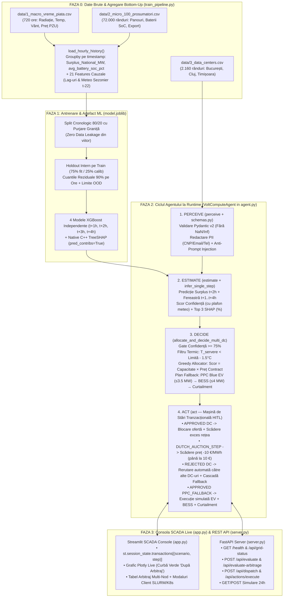

# ⚙️ VoltCompute — Fluxul Tehnic Complet din Spatele Aplicației (`README_FLOW.MD`)

Acest document explică pas cu pas **tot ce se întâmplă în spatele aplicației VoltCompute** — de la citirea și agregarea celor 72.000 de înregistrări din fișierele CSV, până la antrenarea modelului **XGBoost ($t+2\text{h}$)**, calculul explicabilității **TreeSHAP**, mașina de stări a agentului (**Perceive → Estimate → Decide → Act**), licitația **Dutch Auction**, rerutarea între Data Centers, **Cascada de Fallback (PPC Blue EV → BESS → Curtailment)** și actualizarea în timp real a graficului SCADA din **Streamlit (`app.py`)** și **FastAPI (`server.py`)**.

---

## 1. Arhitectura End-to-End (Privire de Ansamblu)

Produsul este construit pe o **arhitectură hibridă în 2 straturi**:
1. **Stratul Nedeterminist / Probabilistic (Machine Learning — `train_pipeline.py`):** Prezice cu **2 ore în avans ($t+2\text{h}$)** cât curent verde va fi injectat în rețea, care este intervalul de incertitudine și care sunt factorii cauzali (**TreeSHAP**).
2. **Stratul Determinist / Safety-First (`agent.py` & `schemas.py`):** Aplică reguli fizice, termice și financiare stricte (fără risc de halucinație), controlează alocarea megawaților, negocierile și aprobarea umană (**Human-in-the-Loop** conform **EU AI Act**).



---

## 2. Faza 0: Ingestia Datelor și Agregarea „Bottom-Up” (`train_pipeline.py`)

### 2.1. De ce Agregare „Bottom-Up”?
Într-o rețea reală cu mii de prosumatori, nu se antrenează câte un model ML pentru fiecare gospodărie (zgomotul statistic este uriaș când un consumator pornește un cuptor sau își încarcă mașina). În schimb, funcția [`load_hourly_history()`](train_pipeline.py) aplică **agregarea de jos în sus**:

1. **Citește `data/2_micro_100_prosumatori.csv` (72.000 rânduri = 100 prosumatori × 720 ore)** și grupează după `timestamp`:
   - **`Surplus_National_MW`**: Suma tuturor exporturilor în rețea convertită din kW în MW:
     $$\text{Surplus\_National\_MW}_t = \frac{1}{1000} \sum_{i=1}^{100} \text{export\_in\_retea\_kw}_{i,t}$$
   - **`avg_battery_soc_pct`**: Gradul mediu de încărcare a bateriilor prosumatorilor (ponderat cu capacitatea totală instalată a bateriilor):
     $$\text{avg\_battery\_soc\_pct}_t = \frac{\sum_{i=1}^{100} \text{baterie\_curenta\_kwh}_{i,t}}{\sum_{i=1}^{100} \text{capacitate\_bat\_kwh}_{i,t}} \times 100$$
     *Rol critic în model:* Dimineața, prosumatorii își încarcă propriile baterii și exportă `0 kW`. Când la ora **11:00** `avg_battery_soc_pct` ajunge la **>80%**, modelul ML știe că peste 2 ore (la ora **13:00**) bateriile vor atinge 100% și tot curentul solar se va vărsa brusc în rețeaua PPC!
   - **`total_prosumer_load_mw`**: Consumul casnic agregat al gospodăriilor ($\sum \text{consum\_kw} / 1000$).

2. **Fuzionează 1-la-1 cu `data/1_macro_vreme_piata.csv` (720 ore):**
   - Adaugă condițiile meteo regionale (`temp_c`, `radiatie_solara_wm2`, `viteza_vant_kmh`) și prețul bursier spot (`pret_pzu_eur_mwh`).
   - Verifică integritatea seriei temporale (exact 720 de pași consecutivi la interval de `1h`).

3. **Construiește cele 21 de Atribute Cauzale (`FEATURE_NAMES`):**
   - **Timp & Calendar (5 features):** `hour`, `dayofweek`, `is_weekend`, `hour_sin`, `hour_cos` (codificare trigonometrică ciclică pentru continuitatea orei `23:00 -> 00:00`).
   - **Observații la momentul $t$ (7 features):** `temp_c`, `radiatie_solara_wm2`, `viteza_vant_kmh`, `pret_pzu_eur_mwh`, `Surplus_National_MW`, `avg_battery_soc_pct`, `total_prosumer_load_mw`.
   - **Lag-uri istorice la $t-1\text{h}, t-2\text{h}, t-24\text{h}$ (6 features):** `surplus_lag_1`, `surplus_lag_2`, `surplus_lag_24`, `temp_lag_1`, `radiatie_lag_1`, `pret_lag_1`.
   - **Estimatori meteo sezonieri pentru $t+2\text{h}$ (3 features):** `seasonal_radiation_t_plus_2`, `seasonal_temp_t_plus_2`, `seasonal_wind_t_plus_2` (calculate strict cauzal din observația de la $t - 22\text{h} = (t + 2\text{h}) - 24\text{h}$, fără a atinge niciodată rândurile viitoare $t+1$ sau $t+2$!).

---

## 3. Faza 1: Antrenarea ML, Calibrarea Confidenței și TreeSHAP (`train_pipeline.py`)

Când rulezi `python train_pipeline.py`, se execută următorii pași în **~3.2 secunde**:

1. **Definirea Țintei ($t+2\text{h}$) și a Baseline-urilor:**
   - `target` = `Surplus_National_MW.shift(-2)` (valoarea reală de peste 2 ore).
   - Se elimină primele 24 de ore (unde lag-ul de 24h este `NaN`) și ultimele 2 ore (unde `shift(-2)` este `NaN`), rezultând **694 de ferestre orare complete**.
   - Se evaluează două modele de referință (**Baseline**) pe setul de test:
     - **Baseline Persistență ($\hat{y}_{t+2} = y_t$):** `MAE = 0.058285 MW`, $R^2 = 0.2626$.
     - **Baseline Sezonier 24h ($\hat{y}_{t+2} = y_{t-22}$):** `MAE = 0.010566 MW`, $R^2 = 0.9630$.

2. **Split Cronologic 80/20 cu Purjarea Graniței (`Purged Time-Series Split`):**
   - Primele 80% din rânduri formează setul de antrenare (`train`), iar ultimele 20% (`139 ore`) formează setul de test (`test`).
   - **Detaliu critic de inginerie ML:** Ultimele 2 rânduri din `train` (ale căror ținte $t+2\text{h}$ ar cădea în interiorul perioadei de `test`) sunt **purjate automat** (`purged_rows = 2`), garantând matematic **zero data leakage** între train și test (`train_rows = 553`).

3. **Calibrarea Incertitudinii pe Holdout Intern din Train:**
   - Setul `train` este împărțit cronologic în `75% fit` și `25% calibration`.
   - Un model pilot `XGBRegressor` este antrenat pe `fit`, iar erorile absolute $|\hat{y} - y|$ sunt măsurate pe `calibration`.
   - Se extrage **cuantila de 90% a erorilor reziduale** atât global (`quantile`), cât și pentru fiecare oră din zi (`hourly_quantiles`), împreună cu limitele minime/maxime văzute la antrenare pentru fiecare atribut (`feature_bounds`).

4. **Antrenarea `XGBRegressor` și Calculul Exact `TreeSHAP`:**
   - Se antrenează modelul canonic `XGBRegressor(n_estimators=240, max_depth=3, learning_rate=0.045)` pentru $t+2\text{h}$, obținând pe setul de test **`MAE = 0.006883 MW`**, **`RMSE = 0.014690 MW`** și **$R^2 = 0.984078$** (reducere de **88.2% a erorii MAE** față de baseline-ul de persistență).
   - Se antrenează suplimentar modelele cauzale pentru $t+1\text{h}, t+3\text{h}, t+4\text{h}$ (`train_forecast_models`) folosind aceeași graniță înghețată de train/test.
   - Toate modelele, metadatele de calibrare, limitele fizice și importanțele globale **TreeSHAP** sunt serializate în `model.joblib`, `models/model.joblib` și `models/metrics.json`.

---

## 4. Faza 2: Ciclul Decizional al Agentului (`VoltComputeAgent` în `agent.py`)

La fiecare pas orar $T$ (fie în dashboard-ul Streamlit, fie la un apel API pe `/api/evaluate-arbitrage`), agentul execută secvențial cele **4 etape**:

### Etapa 1: `perceive()` — Validare Telemetrie & Securitate OWASP (`schemas.py` & `agent.py`)
1. **Validare numerică și fizică strictă:**
   - Toate modelele moștenesc `BaseModel` cu `ConfigDict(allow_inf_nan=False, validate_assignment=True)`.
   - Dacă un senzor trimite `NaN`, `Infinity`, o oră în afara `0..23` sau o iradianță negativă, validarea eșuează în mod **fail-closed**, iar `perceive()` returnează imediat o decizie cu `status = "DATA_ERROR"`, `allocated_mw = 0.0` și `confidence_score = 0.0`.
2. **Redactare PII și Scut Anti-Prompt Injection (`redact_pii_and_guard_injection`):**
   - Orice câmp text (`operator_notes`, parametri custom etc.) este curățat automat înainte de validare:
     - **CNP-uri (13 cifre)** $\rightarrow$ `[CNP_REDACTED]`
     - **Adrese de e-mail** $\rightarrow$ `[EMAIL_REDACTED]`
     - **Numere de telefon RO** $\rightarrow$ `[PHONE_REDACTED]`
   - Textul este normalizat Unicode (fără diacritice, cu newline-urile colapsate în spații) și verificat contra șabloanelor de atac OWASP LLM01 (*"Ignore previous instructions"*, *"Ignoră instrucțiunile anterioare"*, `system prompt`, `<|im_start|>`). Dacă este detectată o tentativă de injecție, request-ul este blocat instant.

### Etapa 2: `estimate()` — Inferență ML la $t+2\text{h}$, Confidență & TreeSHAP (`train_pipeline.py` & `agent.py`)
1. **Inferența la $t+2\text{h}$ (`infer_single_step`):**
   - Extrage cele 21 de features în ordinea exactă din `artifact["feature_names"]` și verifică încadrarea în limitele fizice.
   - Calculează predicția `raw_prediction_mw` și `predicted_export_mw = max(0.0, raw_prediction_mw)`.
2. **Calculul `TreeSHAP` nativ (`pred_contribs=True`):**
   - Apelează direct motorul C++ din `XGBoost` (`booster.predict(DMatrix(frame), pred_contribs=True)`), care returnează contribuția exactă în MW a fiecăruia dintre cele 21 de atribute, respectând identitatea aditivă:
     $$\sum_{j=1}^{21} \text{SHAP}_j + \text{BaseValue} = \text{raw\_prediction\_mw}$$
   - Selectează primele 3 atribute după modulul contribuției (`top_shap_features`) și le normalizează procentual în `shap_percentages` (ex. `radiatie_solara_wm2: 52%`, `avg_battery_soc_pct: 31%`, `surplus_lag_24: 17%`).
3. **Calculul Scorului de Confidență (`confidence_score`) și Plafonul Meteo:**
   - Din calibrarea pe reziduuri se extrage raza de incertitudine `radius` pentru ora curentă și eventuala penalizare Out-of-Distribution (`ood`):
     $$\text{confidence} = \text{clip}\left(1.0 - \frac{\text{radius}}{\text{scale}} - \min(0.5, 0.1 \times \text{ood}),\; 0.0,\; 1.0\right)$$
   - Dacă telemetria include un indice de stabilitate atmosferică scăzut (`weather_stability_index = 0.58` în scenariul de furtună/front atmosferic), agentul aplică **obligatoriu** plafonul:
     $$\text{confidence\_score} = \min(\text{confidence},\; \text{weather\_stability\_index})$$
     *(Chiar dacă cineva trimite `confidence_override = 0.99`, acesta nu poate ocoli niciodată un `weather_stability_index` nesigur!)*
4. **Fereastra Multi-Orizont ($t+1\dots t+4\text{h}$):**
   - Funcția `infer_forecast_window()` rulează toate cele 4 modele XGBoost (`1h, 2h, 3h, 4h`) pentru a popula curba predictivă și barele de eroare din graficul SCADA.

### Etapa 3: `decide()` / `allocate_and_decide_multi_dc()` — Siguranță Termică, Greedy Allocator & Plan Fallback
1. **Verificarea Pragului de Confidență (`Confidence Gate >= 0.75`):**
   - Dacă `confidence_score < 0.75`, agentul oprește orice alocare automată: toate centrele primesc `offered_mw = 0.0`, iar decizia primește `status = "ESCALATE_TO_HUMAN"` (afișând în UI alerta galbenă **`⚠️ STATUS: UNCERTAIN — Preluat de Operator Uman`** și dezactivând butoanele de aprobare).
2. **Filtrul Termic Strict (`Hard Thermal Safety Constraint`):**
   - Pentru fiecare centru de date din `data/3_data_centers.csv` (`DC_AI_BUCURESTI`, `DC_CLOUD_CLUJ`, `DC_EDGE_TIMISOARA`), agentul verifică temperatura din sala serverelor:
     $$\text{Dacă } T_{\text{servere}} \ge T_{\text{limită}} - 1.5^\circ\text{C} \implies \text{status} = \texttt{"REJECTED\_THERMAL\_SAFETY"},\; \text{offered\_mw} = 0.0$$
3. **Ordonarea Prioritară și Alocarea Constrânsă (`Constrained Greedy Allocation`):**
   - Centrele eligibile sunt sortate descrescător după scorul economic:
     $$\text{PriorityScore}_{dc} = \text{capacitate\_libera\_mw}_{dc} \times \text{pret\_contract\_eur\_mwh}_{dc}$$
   - Se alocă secvențial din surplusul disponibil la tariful verde Flash Deal (`30.0 EUR/MWh`):
     $$\text{offered\_mw}_{dc} = \min\left(\text{SurplusRămas},\; \text{capacitate\_libera\_mw}_{dc}\right)$$
4. **Planificarea Automată a Cascadei de Fallback (`_fallback`):**
   - Orice surplus rămas neabsorbit de centrele de date (`remaining = Surplus - sum(offered_mw)`) este repartizat determinist pe **3 trepte de siguranță**:
     1. **Treapta 1 — Stații EV `PPC Blue`:** $\text{ev} = \min(3.5\text{ MW},\; \text{remaining})$
     2. **Treapta 2 — Baterii Industriale `BESS`:** $\text{bess} = \min(4.0\text{ MW},\; \text{remaining} - \text{ev})$
     3. **Treapta 3 — `Curtailment Asistat SCADA`:** $\text{curtail} = \max(0.0,\; \text{remaining} - \text{ev} - \text{bess})$
   - Astfel, în orice moment este respectată **legea de conservare a energiei**:
     $$\sum_{dc} \text{offered\_mw}_{dc} + \text{ev} + \text{bess} + \text{curtail} = \text{surplus\_predicted\_mw}$$

### Etapa 4: `act()` — Mașina de Stări Tranzacțională Human-in-the-Loop (`agent.py`)
Toate deciziile emise de `run_cycle()` sunt doar **planuri propuse** (`execution_mode = "planned"`, `executed_mw = 0.0`) până când operatorul uman interacționează cu ele:

1. **Când operatorul apasă `Acceptă & Scalează` (`action = "APPROVED"` pe un Data Center):**
   - Oferta acelui centru trece din `OFFER_GENERATED` în **`ACCEPTED`** (și devine **imuabilă** și **idempotentă**: un al doilea click returnează `ALREADY_SIMULATED` cu `0 MW` suplimentari).
   - Se adună megawații în `decision.executed_mw` și `decision.executed_absorbed_mw`.
   - Se calculează venitul PPC realizat (`offered_mw × offered_price_eur`), economia financiară a centrului de date (`offered_mw × (contract_price - offered_price)`) și emisiile evitate (`executed_mw × 0.28 tCO₂/MWh`).
   - Se recalculează excesul fizic rămas în rețea (`remaining_grid_excess_mw`).

2. **Când operatorul apasă `−10 €/MWh` (`action = "DUTCH_AUCTION_STEP"` — Licitație Olandeză):**
   - Prețul ofertei pentru acel Data Center scade cu `10 EUR/MWh` (ex. `30 € → 20 € → 10 €/MWh`, plafonat jos la pragul de rentabilitate de `10 EUR/MWh`).
   - Se incrementează runda licitației (`auction_round += 1`) și se actualizează procentul de discount (`discount_pct`) și economia estimată a clientului.

3. **Când operatorul apasă `Refuză` (`action = "REJECTED"` pe un Data Center):**
   - Centrul refuzat trece în **`REJECTED_BY_OPERATOR`**, iar `offered_mw` devine `0.0`.
   - **Rerutare inteligentă între centre:** Cota de megawați refuzată (`quota`) este oferită automat următorului centru de date eligibil (care nu este în risc termic și nu a fost deja acceptat/refuzat), în limita capacității sale libere disponibile, la noul preț redus prin Dutch Auction!
   - **Activarea Cascadei de Fallback:** Dacă celelalte centre de date sunt deja pline (sau au fost refuzate), megawații rămași intră automat în `decision.fallback` (**Treapta 1: `PPC Blue EV` $\rightarrow$ Treapta 2: `BESS` $\rightarrow$ Treapta 3: `Curtailment`**), iar numărul de revizie `fallback_plan_revision` crește automat.

4. **Când operatorul apasă `✅ Aprobă Fallback EV / BESS / Curtailment` (`center_id = "PPC_FALLBACK"`, `action = "APPROVED"`):**
   - Metoda `_approve_fallback()` verifică revizia planului (`fallback_revision == decision.fallback_plan_revision`) și execută simulat **doar diferența neexecutată (`delta`)** pentru `PPC Blue EV`, `BESS` și `Curtailment`.
   - Adună energia absorbită de EV și BESS în `executed_absorbed_mw` și scade corespunzător `remaining_grid_excess_mw`.

---

## 5. Faza 3: Cum Funcționează Consola SCADA (`app.py`) și Serverul API (`server.py`)

### 5.1. Gestiunea Stării în `app.py` (`st.session_state.transactions`)
- La fiecare interacțiune (schimbare oră pe slider, click pe scenariu, click pe `Acceptă`, `−10 €/MWh` sau `Refuză`), Streamlit re-execută scriptul `app.py`.
- Pentru ca nicio tranzacție aprobată sau negociată să nu se piardă, `app.py` salvează fiecare stare într-un dicționar tranzacțional în memorie indexat după cheie:
  ```python
  tx_key = (scenario, step, status["data_source"])
  ```
- Astfel, poți aproba o ofertă pe `☀️ Amiază Însorită` la ora `11:00`, poți comuta pe `⛈️ Front Instabil` sau `🔥 Avarie Chiller` ca să le arăți juriului, și când revii pe `☀️ Amiază Însorită`, tranzacția ta aprobată este păstrată intactă!
- În momentul în care `executed_reduction = decision.executed_absorbed_mw + decision.executed_curtailment_mw > 0`, graficul principal Plotly desenează automat curba verde **`Injecție netă după Arbitraj (Rețea Salvată)`** și schimbă alerta roșie de sus în bannerul verde **`✅ REȚEA SALVATĂ ÎN SIMULARE`**.

### 5.2. Endpoint-urile FastAPI (`server.py`)
Serverul FastAPI expune exact același nucleu `VoltComputeAgent` prin rute REST validate cu Pydantic v2:
- `GET /health` — starea serviciului, confirmarea încărcării `model.joblib` și metricile `MAE / RMSE / R²`.
- `GET /api/grid-status?step=35` — telemetria rețelei la pasul orar solicitat, `avg_battery_soc_pct` și starea celor 3 centre de date din CSV.
- `POST /api/evaluate` și `POST /api/evaluate-arbitrage` — rulează `agent.run_cycle(...)`, salvează decizia în `DECISION_STORE` și returnează JSON-ul complet (`AgentDecision` cu `dc_offers`, `fallback`, `top_shap_features`, `forecast_window`).
- `POST /api/dispatch` și `POST /api/actions/execute` — aplică acțiunea operatorului (`APPROVED`, `DUTCH_AUCTION_STEP`, `REJECTED` pe un centru de date sau `APPROVED` pe `PPC_FALLBACK`) și returnează `DispatchResponse` cu noile totaluri executate și excesul rămas în rețea.
- `GET /api/simulation/{scenario_name}` și `POST /api/simulate-scenario` — rulează simularea pe 24 de ore și calculează KPI-urile agregate de impact financiar și sustenabilitate.
