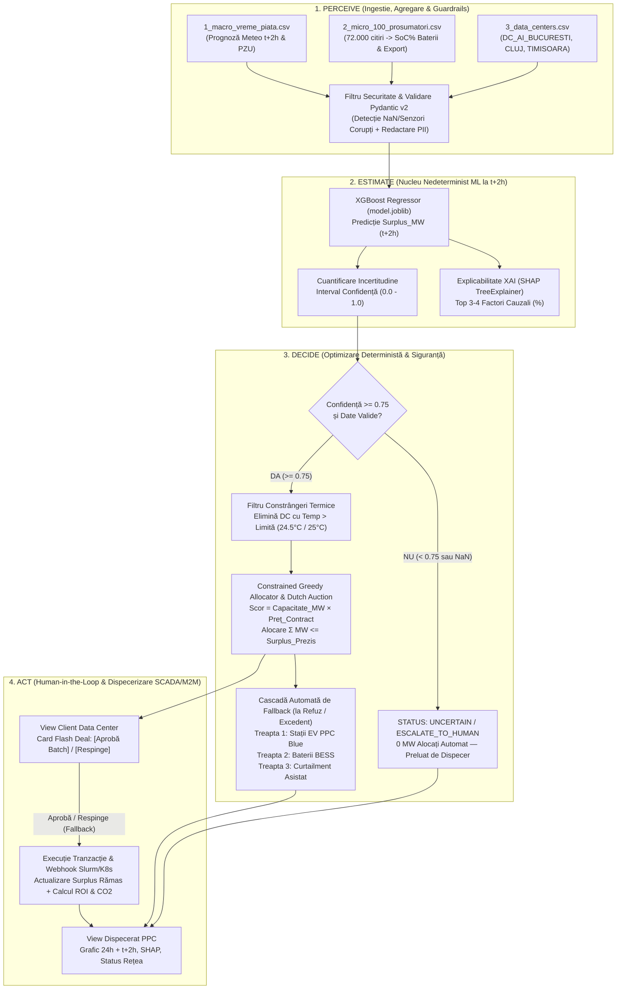

# ⚡ PLAN DE ARHITECTURĂ ȘI IMPLEMENTARE — VoltCompute (PPC Energy Arbitrage & Intraday AI Agent)

> **Document de Arhitectură & Planificare Tehnică (`docs/PLAN.md`)**  
> **Sursă cerințe:** `docs/Req.pdf`, `docs/FIRST-PROMPTS.md`, `AGENTS.md`  
> **Rol:** Principal Systems & AI Architect  
> **Status:** Propunere arhitecturală completă — în așteptarea aprobării umane înainte de execuția codului în worktree-uri.

---

## 1. Viziunea Produsului & Diagnosticul Arhitectural (As-Is vs. To-Be)

### 1.1. Problema de Business (PPC Renewables & Rețele Electrice)
În zilele cu radiație solară și vânt puternic (intervalul critic **11:00–15:00**), bateriile prosumatorilor ating **100% State of Charge (SoC)** în jurul orei 11:00, iar întreaga energie produsă ulterior se varsă brusc în rețeaua de joasă/medie tensiune (`export_in_retea_kw`), concomitent cu producția parcurilor industriale PPC.
- **Efect tehnic:** Tensiunea în rețea depășește limita de siguranță (253V / limită linie), forțând **curtailment** (oprirea fizică a invertoarelor și risipă de energie verde).
- **Efect financiar:** Pe piața spot (**PZU / Intraday**), prețul energiei se prăbușește sub `15 EUR/MWh` sau devine **negativ** (`-15 .. 0 EUR/MWh`), generând pierderi masive de dezechilibru pentru PPC.
- **De ce abordarea deterministă (`IF surplus > 5 MW THEN sell`) eșuează:** La momentul $t$ când contorul arată deja surplus, este prea târziu — sistemele HVAC/Chillers ale unui Data Center necesită **15–30 minute** pentru pre-răcire, iar containerele GPU (Kubernetes/Slurm) necesită **3–7 minute** pentru pornire și încărcarea datelor.

### 1.2. Soluția Arhitecturală: Arhitectură Hibridă (AI Probabilistic la $t+2h$ + Optimizare Deterministă)
**VoltCompute** acționează pe **Piața Intrazilnică (Intraday)** cu o fereastră anticipativă de **2 ore în avans ($t+2h$)**:
1. **Stratul Nedeterminist / Probabilistic (PERCEIVE & ESTIMATE — Machine Learning):**
   - Agregă *Bottom-Up* telemetria de la cei 100 de prosumatori (`2_micro_100_prosumatori.csv` — 72.000 înregistrări), în special **gradul mediu de încărcare a bateriilor (`avg_battery_soc_pct`)** și exportul curent, fuzionat cu prognoza meteo și piața PZU (`1_macro_vreme_piata.csv` — 720 ore).
   - Utilizează **XGBoost Regressor** + **Quantile / Residual Uncertainty** + **SHAP TreeExplainer** pentru a prezice `predicted_surplus_mw` la $t+2h$, intervalul de confidență (`confidence_score`) și ponderile cauzale exacte (`top_shap_features`).
2. **Stratul Determinist & Controlat (DECIDE & ACT — Safety-First Agent):**
   - Aplică reguli industriale stricte, auditabile 100% și fără risc de halucinație:
     - **Filtru Confidență (EU AI Act High-Risk Compliance):** Dacă `confidence_score < 0.75` sau datele conțin valori lipsă/invalide $\rightarrow$ `UNCERTAIN / ESCALATE_TO_HUMAN`.
     - **Filtru Constrângeri Termice (Hard Safety Constraint):** Elimină automat de la ofertare orice Data Center cu `temp_servere_c >= limita_termica_c - 1.5°C` (sau `> 24.5°C` / `26.0°C`).
     - **Constrained Greedy Allocation & Dutch Auction:** Clasifică centrele de date eligibile (`DC_AI_BUCURESTI`, `DC_CLOUD_CLUJ`, `DC_EDGE_TIMISOARA` din `3_data_centers.csv`) după scorul de oportunitate B2B și alocă megawații fără a depăși surplusul prezis ($\sum E_{\text{alocat}} \le \text{Surplus}_{t+2h}$).
     - **Cascadă Automată de Fallback (3 Trepte la Refuz):**
       1. **Dutch Auction / Rerutare B2B:** Scădere dinamică de preț (pas `-10 EUR/MWh` până la pragul minim) și ofertare secvențială către următorul Data Center din clasament.
       2. **Treapta 1 Fallback:** Rerutare către rețeaua **PPC Blue** (stații de încărcare rapidă EV cu discount dinamic).
       3. **Treapta 2 Fallback:** Stocare în **Baterii Industriale de Rețea (BESS)**.
       4. **Treapta 3 Fallback:** **Curtailment Asistat** (comandă controlată SCADA, doar pentru reziduul neabsorbit).

### 1.3. Diagnosticul Codului Existent în Repository (Gap Analysis)
În urma auditului tehnic asupra repository-ului curent (`branch: mihai`), am identificat următoarele discrepanțe critice care trebuie rezolvate:

| Componentă | Starea Actuală în Repo (`As-Is`) | Gap față de `docs/Req.pdf` (`To-Be`) | Decizie Inginerească |
| :--- | :--- | :--- | :--- |
| **Date & ML (`train_pipeline.py` vs `train.py`)** | Există două scripturi paralele: `train.py` (sintetic vechi) și `train_pipeline.py` (folosește `1_macro_vreme_piata.csv` și `2_micro_100_prosumatori.csv`, salvând `model.joblib`). | `train_pipeline.py` nu extrage încă `avg_battery_soc_pct` din bateriile prosumatorilor, nu calculează **Baseline-ul obligatoriu de Persistență** ($\hat{y}_{t+2}=y_t$ și $\hat{y}_{t+2}=y_{t-22}$), și nu salvează explicațiile `shap.TreeExplainer` în `model.joblib`. | Unificăm pipeline-ul în `train_pipeline.py`, adăugăm feature-ul cheie de baterie (`avg_soc_pct`), tabelul comparativ **Baseline vs. XGBoost** (MAE, RMSE, $R^2$) și exportul SHAP în `model.joblib` + `models/metrics.json`. |
| **Inferență Agent (`agent.py`)** | `agent.py` încarcă `model.joblib`, dar caută cheia `"feature_columns"` cu numele vechi (`solar_irradiance_wm2`), în timp ce `train_pipeline.py` salvează cheia `"feature_names"` cu numele din CSV-urile reale (`radiatie_solara_wm2`, `surplus_lag_1` etc.), căzând silențios pe fallback-ul fizic! | Agentul trebuie să execute inferența reală pe `model.joblib` la $t+2h$, să suporte schema reală din `1_macro`, `2_micro`, `3_data_centers` și să includă **Dutch Auction + Cascada de Fallback (PPC Blue EV -> BESS -> Curtailment)** + **Filtru Securitate PII/Prompt Injection**. | Refactorizăm `agent.py` cu un adaptor bidirecțional curat (compatibil și cu testele existente din `tests/test_robustness.py`, și cu noile fluxuri multi-DC + fallback în cascadă). |
| **Backend API (`server.py`)** | Expune `/health`, `/api/evaluate`, `/api/dispatch`, `/api/simulation/{scenario_name}`. | `Req.pdf` (p. 15–16) specifică și rutele `/api/grid-status`, `/api/evaluate-arbitrage`, `/api/simulate-scenario`, `/api/actions/execute`. | Păstrăm rutele existente (zero breaking changes pentru teste) și adăugăm cele 4 rute din `Req.pdf` mapate pe același nucleu `VoltComputeAgent`. |
| **Frontend (`app.py`)** | Folosește `data/energy_datacenter_data.csv` și centre de date hardcodate (`ROEDUNET-UPB`), fără cascada de fallback (PPC Blue / BESS), fără Dutch Auction la refuz și fără evidențierea stării bateriilor prosumatorilor. | Trebuie conectat la cele 3 fișiere CSV reale (`1_macro`, `2_micro`, `3_data_centers`), structurat clar pe **Perceive → Estimate → Decide → Act**, cu culori **PPC Brand**, grafic **SHAP**, **Dutch Auction** și **Cascada Fallback** interactivă. | Modernizăm `app.py` păstrând ergonomia de terminal bursier live, dar alimentat din datele reale 720h și cu toate mecanismele interactive cerute la pitch. |

---

## 2. Decizii de Inginerie de Arhitectură (ADR — Architecture Decision Records)

### ADR-01: Agregare Bottom-Up cu Semnal de Saturație a Bateriilor (`avg_battery_soc_pct`)
- **Context:** Prezicerea individuală a mii de prosumatori nu scalează în timp real și introduce zgomot statistic masiv.
- **Decizie:** Aplicăm **Bottom-Up Aggregation** pe `data/2_micro_100_prosumatori.csv` la nivel de `timestamp` orar, extrăgând două semnale macro esențiale:
  1. `Surplus_National_MW` = $\frac{1}{1000} \sum_{i=1}^{100} \text{export\_in\_retea\_kw}_{i,t}$
  2. `avg_battery_soc_pct` = $\frac{\sum \text{baterie\_curenta\_kwh}_{i,t}}{\sum \text{capacitate\_bat\_kwh}_{i,t}} \times 100$
- **Justificare Tehnică & Pitch:** Când la ora 11:00 `avg_battery_soc_pct` trece de **80%** și prognoza meteo pe $t+2h$ indică `radiatie_solara_wm2 > 700 W/m²`, modelul XGBoost anticipează cu precizie $>90\%$ că la ora 13:00 bateriile nu vor mai absorbi nimic, iar tot curentul va inunda rețeaua PPC.

### ADR-02: Cuantificarea Incertitudinii și Pragul de Siguranță (`Confidence Gate`)
- **Context:** Conform regulamentului PPC și **EU AI Act (High-Risk Critical Infrastructure)**, un model AI nu are voie să comande autonom comutări de putere când prognoza este incertă sau senzorii sunt degradați.
- **Decizie:**
  - Calculăm `confidence_score` $\in [0.0, 1.0]$ combinând dispersia predicției (intervalul inter-cuantilic / eroarea reziduală locală) cu stabilitatea atmosferică și integritatea senzorilor.
  - Dacă lipsesc senzori critici (NaN neimputabil / valori în afara limitelor fizice) $\rightarrow$ `status = "DATA_ERROR"` (`0 MW` alocați).
  - Dacă `confidence_score < 0.75` $\rightarrow$ `status = "ESCALATE_TO_HUMAN"` (UI afișează explicit badge-ul **`STATUS: UNCERTAIN — Preluat de Operator Uman`** și blochează dispecerizarea M2M automată).

### ADR-03: Motorul Determinist de Alocare & Cascadă de Fallback (Multi-DC + Dutch Auction + PPC Blue + BESS)
- **Context:** Ce se întâmplă dacă există 8 MW în surplus, dar un singur Data Center poate absorbi doar 5 MW, sau dacă un Data Center este în risc termic / refuză oferta?
- **Decizie:** Implementăm în `VoltComputeAgent` o mașină de stări deterministă în **4 pași**:
  1. **Hard Thermal Cutoff:** Orice centru din `3_data_centers.csv` cu `temp_servere_c > limita_termica_c - 1.5°C` (sau `> 25.0°C` în profilul standard) primește instant statusul `REJECTED_THERMAL_SAFETY` (`0 MW`).
  2. **Priority Scoring & Constrained Greedy Allocation:**
     $$\text{Score}_{dc} = \text{capacitate\_libera\_mw}_{dc} \times \text{pret\_contract\_eur\_mwh}_{dc}$$
     Alocăm secvențial în ordinea descrescătoare a scorului:
     $$\text{Allocated}_{dc} = \min\left(\text{SurplusRămas}, \text{capacitate\_libera\_mw}_{dc}\right)$$
     garantând matematic $\sum \text{Allocated}_{dc} \le \text{SurplusPrezis}_{t+2h}$.
  3. **Dutch Auction (Licitație Olandeză la Refuz B2B):**
     - Oferta inițială pleacă de la tariful Flash Deal (ex. **50% discount** față de contract sau tariful promoțional de **30.0 EUR/MWh**).
     - Dacă un Data Center apasă **[Respinge Ofertă]**, agentul poate:
       - **(a)** reduce tariful în trepte de `-5 / -10 EUR/MWh` până la pragul minim de rentabilitate (`10.0 EUR/MWh`, net superior prețului negativ de pe PZU), și/sau
       - **(b)** redistribui instant cota refuzată către celelalte centre de date eligibile cu capacitate liberă.
  4. **Cascada Automată de Fallback (când capacitatea Data Centers este epuizată sau ofertele sunt refuzate):**
     - **Treapta 1 — PPC Blue (EV Fast Charging Network):** Până la `3.5 MW` absorbiți prin activarea automată a unui tarif dinamic redus în aplicația PPC Blue pentru șoferii de vehicule electrice.
     - **Treapta 2 — BESS (Battery Energy Storage System):** Până la `4.0 MW` direcționați către bateriile staționare de medie tensiune ale PPC.
     - **Treapta 3 — Curtailment Asistat:** Orice rest rezidual $> 0\text{ MW}$ este marcat pentru limitare controlată în SCADA.

### ADR-04: Securitate OWASP LLM / AI & Conformitate EU AI Act
- **Context:** Juriul PPC punctează explicit securitatea datelor (redactare PII, protecție Prompt Injection) și încadrarea în EU AI Act.
- **Decizie:** Implementăm un modul dedicat de gardă (`security_guardrails`) direct în `schemas.py` / `agent.py`:
  - **Redactare PII automată (Regex/ Rules):** Orice text liber intrat în sistem (note dispecer, justificări, simulări de tichete/scenarii) trece printr-o funcție `redact_pii(text)` care maschează automat **CNP-uri** (`[CNP_REDACTED]`), **numere de telefon** (`[PHONE_REDACTED]`) și **adrese de e-mail** (`[EMAIL_REDACTED]`).
  - **Protecție Prompt Injection (OWASP LLM01):** Delimitatori structurali stricți (`### Context: ... ###`) și blocarea șabloanelor de tip *"Ignoră instrucțiunile anterioare"* / *"Ignore previous instructions"*.

---

## 3. Arhitectura Sistemului & Fluxul de Execuție



---

## 4. Contracte de Date & API (Agreed Contracts — Înainte de Implementarea Paralelă)

Conform regulii din `AGENTS.md` (*"Backend/frontend agents must agree on API contracts BEFORE parallel implementation"*), următoarele contracte în `schemas.py` și `server.py` sunt **înghețate și obligatorii** pentru toate ramurile de lucru:

### 4.1. Modele Pydantic (`schemas.py`)
Se păstrează integral modelele existente (`GridTelemetry`, `ResearchCenterTelemetry`, `AgentDecision`, `DispatchAction`) pentru compatibilitate 100% cu testele actuale (`tests/test_robustness.py`), și se extind cu câmpuri opționale cu valori default sigure:

1. **`GridTelemetry` (extensie compatibilă înapoi):**
   - `wind_speed_kmh: Optional[float] = Field(default=12.0, ge=0.0, le=150.0)`
   - `prosumer_battery_soc_pct: Optional[float] = Field(default=55.0, ge=0.0, le=100.0)`
   - `current_surplus_mw: Optional[float] = Field(default=None, ge=0.0)`
   - `operator_notes: Optional[str] = Field(default=None)` *(validat automat cu `redact_pii_and_guard_injection`)*

2. **`DataCenterOffer` (model nou pentru alocarea Multi-DC & Dutch Auction):**
   ```python
   class DataCenterOffer(BaseModel):
       dc_id: str
       dc_name: str
       available_capacity_mw: float
       current_temp_c: float
       thermal_limit_c: float
       contract_price_eur: float
       offered_mw: float
       offered_price_eur: float
       discount_pct: float
       priority_score: float
       status: Literal["OFFER_GENERATED", "ACCEPTED", "REJECTED_BY_OPERATOR", "REJECTED_THERMAL_SAFETY", "STANDBY", "ESCALATE_TO_HUMAN"]
       auction_round: int = 1
   ```

3. **`FallbackAllocation` (model nou pentru Cascada de Fallback PPC):**
   ```python
   class FallbackAllocation(BaseModel):
       ppc_blue_ev_mw: float = 0.0          # Treapta 1: Stații EV PPC Blue
       bess_storage_mw: float = 0.0         # Treapta 2: Baterii industriale BESS
       curtailment_mw: float = 0.0          # Treapta 3: Curtailment asistat
       total_fallback_absorbed_mw: float = 0.0
       active_tier: Literal["NONE", "TIER_1_PPC_BLUE_EV", "TIER_2_BESS_STORAGE", "TIER_3_CURTAILMENT"] = "NONE"
       explanation: str = ""
   ```

4. **`AgentDecision` (extensie compatibilă înapoi):**
   - Păstrează toate câmpurile actuale (`decision_id`, `surplus_predicted_mw`, `confidence_score`, `status`, `allocated_mw`, `fixed_price_eur`, `reasoning`, `top_shap_features`, `similar_historical_cases`, `data_quality_warnings`).
   - Adaugă cu valori default:
     - `prediction_horizon_hours: int = 2`
     - `requires_human_approval: bool = True`
     - `dc_offers: List[DataCenterOffer] = Field(default_factory=list)`
     - `fallback: Optional[FallbackAllocation] = None`
     - `shap_percentages: Dict[str, float] = Field(default_factory=dict)` *(ex. `{"Radiație Solară": 54.0, "Preț PZU Scăzut": 31.0, "Baterii Prosumatori (SoC)": 15.0}`)*

### 4.2. Endpoint-uri REST FastAPI (`server.py`)

| Metodă & Rută | Descriere & Rol | Request Payload | Response |
| :--- | :--- | :--- | :--- |
| `GET /health` | Healthcheck serviciu + status model ML (`model.joblib` încărcat) + metrici baseline vs. XGBoost. | — | `{"status": "healthy", "ml_model_loaded": true, "metrics": {...}}` |
| `GET /api/grid-status` | *(Cerut în `Req.pdf` T2.2)* Întoarce starea curentă a rețelei la pasul $t$ (sau `step` din query param), starea bateriilor prosumatorilor și profilul celor 3 Data Centers din CSV. | Query: `?step=13` (opțional) | `GridStatusResponse` (telemetrie rețea + listă Data Centers + preț PZU) |
| `POST /api/evaluate` *(existent)* și `POST /api/evaluate-arbitrage` *(T2.2)* | Rulează ciclul complet `perceive -> estimate (t+2h) -> decide` și returnează `AgentDecision` (cu `dc_offers`, `shap_percentages` și `fallback`). | `EvaluateRequest` (`grid`, `center`, `confidence_override`) | `AgentDecision` |
| `POST /api/simulate-scenario` *(T2.2)* și `GET /api/simulation/{scenario_name}` *(existent)* | Injectează sau rulează un scenariu de test (`CRITICAL_SOLAR_SUNDAY`, `UNCERTAIN_WEATHER_SHOCK`, `DATACENTER_THERMAL_RISK`, sau parametri custom). | `SimulateScenarioRequest` / path param | Timeline 24h + KPI-uri de impact financiar/CO2 + decizii agent |
| `POST /api/dispatch` *(existent)* și `POST /api/actions/execute` *(T2.4)* | Procesează decizia operatorului uman (**Human-in-the-Loop**: `APPROVED`, `REJECTED`, `DUTCH_AUCTION_STEP`). Dacă este `REJECTED`, declanșează automat **Dutch Auction / Cascada de Fallback (PPC Blue EV -> BESS)** și returnează noua stare a rețelei! | `DispatchAction` (extins opțional cu `trigger_fallback: bool = True`, `auction_step: int = 1`) | Stare actualizată rețea + `fallback` activat + economie realizată (EUR) |

---

## 5. Planul de Implementare pe Module și Worktree-uri (Conform `FIRST-PROMPTS.md` & `AGENTS.md`)

Pentru a respecta regulile de izolare din `AGENTS.md` (*"One task branch and worktree per parallel implementation session"*), munca este împărțită în **3 fluxuri de implementare independente** + **1 flux de QA/Review**:

### Fluxul 1: Data Science, ML Pipeline & Core Agent (Backend / ML Worktree)
- **Branch propus:** `feat/backend-ml-arbitrage` (în worktree dedicat sau ramură confirmată)
- **Fișiere deținute:** `train_pipeline.py`, `schemas.py`, `agent.py`, `server.py`, `simulator.py`, `models/metrics.json`, `model.joblib`
- **Sarcini concrete:**
  - [ ] **T1.1 — Pipeline Date & Feature Engineering (`train_pipeline.py`):**
    - Agregă din `data/2_micro_100_prosumatori.csv` atât `Surplus_National_MW`, cât și `avg_battery_soc_pct` (gradul mediu de încărcare a bateriilor prosumatorilor) și `total_prosumer_load_mw`.
    - Fuzionează cu `data/1_macro_vreme_piata.csv` și construiește lag-urile temporale (`surplus_lag_1`, `surplus_lag_2`, `surplus_lag_24`, features ciclice `hour_sin`, `hour_cos`, `dayofweek`, `is_weekend`).
    - Definește ținta `target` = `Surplus_National_MW` la $t+2\text{ ore}$ (`shift(-2)`).
  - [ ] **T1.2 — Antrenare XGBoost vs. Baseline Obligatoriu (`train_pipeline.py`):**
    - Split cronologic strict **80% Train / 20% Test** (`shuffle=False`, zero data leakage).
    - Calculează două baseline-uri de referință pe setul de test:
      1. **Persistence Baseline ($\hat{y}_{t+2} = y_t$)**
      2. **Seasonal 24h Persistence ($\hat{y}_{t+2} = y_{t+2-24}$)**
    - Antrenează `XGBRegressor` pentru predicția centrală + modele cuantice (`reg:quantileerror`, $\alpha \in \{0.10, 0.90\}$) sau deviația reziduală pentru cuantificarea incertitudinii.
    - Afișează în consolă tabela comparativă clară (**Baseline MAE/RMSE/$R^2$ vs. XGBoost MAE/RMSE/$R^2$**) și salvează rezultatele în `models/metrics.json` și `model.joblib`.
  - [ ] **T1.3 — Explicabilitate SHAP & Export Artefacte (`train_pipeline.py` + `agent.py`):**
    - Calculează importanța globală și locală a atributelor (cu `shap.TreeExplainer` dacă pachetul `shap` este instalat, sau atribuire exactă bazată pe arbori / contribuții marginale ca fallback rapid fără latență).
    - Expune funcția `infer_single_step(input_dict)` care returnează predicția la $t+2h$, scorul de confidență și top 3 variabile explicative în procente (ex. `{"Radiație Solară": 54.0, "Preț PZU": 31.0, "SoC Baterii Prosumatori": 15.0}`).
  - [ ] **T2.1 — Securitate, Guardrails & Logica de Arbitraj în Cascadă (`schemas.py`, `agent.py`):**
    - Implementează `redact_pii(text)` (mascare CNP, telefon, email) și protecția anti-Prompt Injection.
    - Aliniază `VoltComputeAgent.estimate()` cu `model.joblib` (suportând atât apelurile din `tests/test_robustness.py`, cât și rândurile din dataset-ul real de 720h).
    - Implementează metoda `allocate_and_decide_multi_dc()` cu:
      - Filtrarea termică a centrelor din `data/3_data_centers.csv` (`DC_AI_BUCURESTI`, `DC_CLOUD_CLUJ`, `DC_EDGE_TIMISOARA`).
      - Scorul determinist $\text{Score}_{dc} = \text{capacitate\_libera\_mw} \times \text{pret\_contract\_eur\_mwh}$.
      - **Dutch Auction** (reducere în trepte de 10 EUR/MWh la refuz) + **Cascada de Fallback în 3 Trepte** (`PPC Blue EV` $\rightarrow$ `BESS` $\rightarrow$ `Curtailment`).
  - [ ] **T2.2 — Extindere FastAPI (`server.py`):**
    - Adaugă rutele `/api/grid-status`, `/api/evaluate-arbitrage`, `/api/simulate-scenario`, `/api/actions/execute` păstrând intacte rutele `/health`, `/api/evaluate`, `/api/dispatch`, `/api/simulation/{scenario_name}`.

### Fluxul 2: Frontend Dashboard & Experiența Live de Pitch (Frontend Worktree)
- **Branch propus:** `feat/frontend-streamlit-dashboard`
- **Fișiere deținute:** `app.py`, `.streamlit/config.toml`
- **Sarcini concrete:**
  - [ ] **T3.1 — Header Oficial PPC & Structură Vizuală P-E-D-A (`app.py`):**
    - Adaugă identitatea vizuală PPC (accente `#0047FF` Albastru PPC, `#FF5500` Portocaliu, `#00A651` Verde pe fundal dark-mode de dispecerat industrial) și badge-urile: **`PPC Renewables + PPC Energy`**, **`EU AI Act Compliant (High-Risk Grid AI)`**, **`Intraday Horizon: t+2h`**, **`PII & Prompt Guard: Active`**.
    - Organizează interfața în cele 4 etape explicite cerute în barem: **1. PERCEIVE**, **2. ESTIMATE**, **3. DECIDE**, **4. ACT**.
    - Adaugă selector rapid de Scenarii Demo (1-Click pentru Juriu):
      1. ☀️ **Amiază Însorită (Surplus Critic & Preț PZU Negativ)** — Demonstrează predicția la $t+2h$ și generarea Flash Deal-ului.
      2. ⛈️ **Front Atmosferic Instabil (Incertitudine ML < 75%)** — Demonstrează blocarea automată și statusul `UNCERTAIN — Preluat de Operator`.
      3. 🔥 **Avarie Chiller Data Center (Protecție Termică > 25°C)** — Demonstrează excluderea automată a centrului supraîncălzit și rerutarea.
  - [ ] **T3.2 — Vizualizare Serii Temporale, Baterii Prosumatori & SHAP (`app.py`):**
    - Conectează dashboard-ul la datele reale agregate din `1_macro_vreme_piata.csv`, `2_micro_100_prosumatori.csv` și `3_data_centers.csv` (cu fallback instant dacă fișierele lipsesc).
    - Afișează pe graficul principal Plotly: curba istorică (ultimele 24h), fereastra de predicție anticipativă ($t+1 .. t+4\text{h}$), linia roșie a limitei de rețea, gradul de încărcare a bateriilor prosumatorilor (`SoC %`) și **efectul vizual de scădere a curbei sub linia roșie după apăsarea butonului [Aprobă]**!
    - Adaugă graficul orizontal **SHAP Feature Importance** (ponderile deciziei în `%` și `MW`) și tabelul comparativ **Baseline MAE vs. XGBoost MAE**.
  - [ ] **T3.3 — Card Interactiv Flash Deal, Dutch Auction & Cascadă Fallback (`app.py`):**
    - În coloana din dreapta (**View Client Data Center & Human-in-the-Loop**):
      - Afișează oferta activă pentru `DC_AI_BUCURESTI` / `DC_CLOUD_CLUJ` / `DC_EDGE_TIMISOARA` (Volum MW, Fereastră $t+2h$, Tarif propus vs. Tarif contractual, Economie în EUR, Garanție de Origine Verde / CO2 evitat).
      - Buton verde: **`[✅ Aprobă & Declanșează Calcul Batch]`** $\rightarrow$ actualizează instant graficul PPC (scade congestia sub limita liniei) și afișează confirmarea webhook-ului Kubernetes/Slurm.
      - Buton galben: **`[📉 Negociază / Dutch Auction (-10 €/MWh)]`** $\rightarrow$ reduce prețul ofertei cu 10 EUR/MWh sau mută oferta la următorul Data Center din clasament.
      - Buton roșu: **`[❌ Respinge Ofertă (Activează Cascada Fallback)]`** $\rightarrow$ comută instantaneu pe **Cardul de Fallback în Cascadă**:
        - **Treapta 1 (PPC Blue EV):** Discount activat la stațiile de încărcare EV.
        - **Treapta 2 (Baterii BESS):** Încărcare stocare staționară.
        - **Treapta 3 (Curtailment Asistat):** Minimul rămas.

### Fluxul 3: QA, Teste de Robustețe & Documentație Pitch (QA Worktree)
- **Branch propus:** `feat/qa-tests-and-docs`
- **Fișiere deținute:** `tests/test_robustness.py`, `README.md`, `requirements.txt`
- **Sarcini concrete:**
  - [ ] **T4.1 — Extinderea Suitei Pytest (`tests/test_robustness.py`):**
    - Păstrează toate cele 5 teste existente (care trebuie să treacă 100%).
    - Adaugă teste unitare focalizate pentru:
      1. **Baseline vs. XGBoost:** Verifică faptul că `test_mae` al modelului XGBoost din `train_pipeline.py` este strict mai mic decât `baseline_persistence_mae`.
      2. **Constrângerea de Volum Multi-DC:** Verifică $\sum \text{Allocated}_{dc} \le \text{SurplusPrezis}$ pe datele din `3_data_centers.csv`.
      3. **Cascada de Fallback & Dutch Auction:** Verifică faptul că la refuzul Data Center-ului (`REJECTED`), surplusul este preluat automat de `PPC Blue EV` și `BESS`.
      4. **Securitate PII & Prompt Injection:** Verifică mascarea automată a unui CNP/email/telefon și blocarea unui payload de tip prompt injection.
  - [ ] **T4.2 — Actualizare `README.md` & Pitch Playbook:**
    - Documentează comenzile exacte de rulare (`python train_pipeline.py`, `pytest -v`, `streamlit run app.py`, `uvicorn server:app`).
    - Include diagrama arhitecturii `Perceive -> Estimate -> Decide -> Act`, tabela reală cu metricile ML (`Baseline` vs. `XGBoost`) și structura pitch-ului de 3 minute / 7 slide-uri.

---

## 6. Criterii Observabile de Acceptare (Definition of Done)

Înainte de orice integrare în `main`, fiecare livrabil va fi verificat obiectiv prin următoarele comenzi și criterii:

1. **Verificare Pipeline ML & Barem (`python train_pipeline.py`):**
   - Rulează fără erori de la cap la coadă în $< 15$ secunde pe baza `data/1_macro_vreme_piata.csv` și `data/2_micro_100_prosumatori.csv`.
   - Afișează în terminal tabela comparativă:
     - `Baseline Persistence MAE` vs. `XGBoost MAE` (cu `XGBoost MAE < Baseline MAE` și $R^2 > 0.80$).
   - Generează `model.joblib` și `models/metrics.json` cu valorile reale.
2. **Verificare Suite de Teste (`pytest -v`):**
   - Toate testele existente și noi din `tests/test_robustness.py` trec cu `0 failed`.
   - Cazurile limită sunt acoperite obiectiv:
     - Date corupte / NaN $\rightarrow$ `status == "DATA_ERROR"`, `allocated_mw == 0.0`.
     - Confidență $< 0.75$ $\rightarrow$ `status == "ESCALATE_TO_HUMAN"`, `allocated_mw == 0.0`.
     - Temperatură servere $> 25.0^\circ\text{C}$ (sau peste limita termică din CSV) $\rightarrow$ centru exclus automat (`0.0 MW`).
     - Refuz ofertă Data Center $\rightarrow$ activare Dutch Auction și Cascadă Fallback (`PPC Blue EV` + `BESS`).
     - Text cu CNP/Email $\rightarrow$ redactat automat (`[CNP_REDACTED]`, `[EMAIL_REDACTED]`).
3. **Verificare API Backend (`uvicorn server:app`):**
   - Toate endpoint-urile (`/health`, `/api/grid-status`, `/api/evaluate`, `/api/evaluate-arbitrage`, `/api/dispatch`, `/api/actions/execute`, `/api/simulation/{scenario}`) răspund cu cod `200 OK` și JSON validat prin Pydantic v2.
4. **Verificare Dashboard Demo (`streamlit run app.py`):**
   - Aplicația pornește fără erori sau warning-uri de deprecieri Streamlit.
   - Demonstrează live în $< 60$ secunde fluxul complet de Pitch:
     `Detecție Surplus la t+2h` $\rightarrow$ `Explicabilitate SHAP` $\rightarrow$ `Flash Deal Data Center` $\rightarrow$ `Simulare Refuz / Fallback PPC Blue EV & BESS` $\rightarrow$ `Aprobare Human-in-the-Loop & Salvare Rețea`.

---

## 7. Registrul de Riscuri Tehnice & Măsuri de Mitigare

| ID | Risc Identificat | Impact | Probabilitate | Mitigare Inginerească în Arhitectură |
| :--- | :--- | :---: | :---: | :--- |
| **R1** | **Nepotrivire de atribute (Feature Mismatch) între `train_pipeline.py` și `agent.py`** | Ridicat (modelul ML este ignorat la runtime) | Medie (existent în codul actual) | Standardizăm dicționarul din `model.joblib` să conțină atât `feature_names`, cât și statisticile de imputare (medii/mediane pe ore), iar `agent.py` construiește vectorul de intrare exact în ordinea din `feature_names`. |
| **R2** | **Lipsa pachetului `shap` sau latență mare la randarea în Streamlit** | Mediu (încetinire UI în timpul demo-ului live) | Medie | Pre-calculăm sau folosim `pred_contribs=True` nativ din `XGBoost` (care calculează exact valorile TreeSHAP în C++ în $<1\text{ ms}$, fără dependențe grele C/numba care pot eșua pe Windows!). |
| **R3** | **Pierderea stării la re-executarea scriptului Streamlit (`st.rerun`)** | Ridicat (resetarea deciziei aprobate/refuzate în timpul pitch-ului) | Mică | Toate stările tranzacționale (`current_step`, `accepted`, `auction_round`, `fallback_state`, `operator_log`) sunt persistate strict în `st.session_state` indexate după pasul temporal `T`. |
| **R4** | **Întrebări capcană de la juriu privind latența fizică a Data Center-elor și PZU** | Mediu (credibilitate de domeniu energetic) | Ridicată | Afișăm direct în UI cronologia operațională de **2 ore (Intraday)**: `0-15 min` Aprobare HITL $\rightarrow$ `15-45 min` Pre-răcire HVAC Chillers $\rightarrow$ `45-60 min` Boot noduri GPU Slurm/K8s $\rightarrow$ `t+2h` Absorbție 100% sincronizată cu vârful solar. |

---

## 8. Structura Pitch-ului de 3 Minute (Aliniată cu Arhitectura Produsului)

1. **Minutul 1 — Problema Reală a PPC & De ce Exclusiv Data Centers:**
   - La prânz, bateriile prosumatorilor ating 100% SoC la ora 11:00, iar la ora 13:00 rețeaua PPC este inundată de megawați verzi nelivrabili, în timp ce prețul PZU devine negativ.
   - Clădirile de birouri și fabricile de ciment sunt rigide; doar **Data Center-ele (clustere AI/HPC)** pot porni mii de containere GPU prin webhook API în câteva minute și au nevoie critică de **Garanții de Origine Verde (ESG)**.
2. **Minutul 2 — Creierul Probabilistic (t+2h) + Decizia Deterministă & Securitatea (EU AI Act):**
   - Noi nu reacționăm cu un `if/else` când rețeaua este deja în avarie: modelul nostru **XGBoost** citește gradul de încărcare a bateriilor la ora 11:00 și prognoza meteo pe **2 ore înainte (Piața Intrazilnică)**, depășind clar modelul Baseline (demonstrat cu metrici MAE/RMSE).
   - Orice decizie este însoțită de **explicabilitate SHAP**, **interval de confidență** (sub 75% $\rightarrow$ escaladare automată la dispecer conform **EU AI Act**) și **filtru termic** pentru protecția serverelor.
3. **Minutul 3 — Demo Live în Dashboard (`app.py`):**
   - **Scenariul 1:** La ora 11:00 agentul prezice vârful de la ora 13:00 și lansează un **Flash Deal** către `DC_AI_BUCURESTI` și `DC_CLOUD_CLUJ`.
   - **Scenariul 2 (Interacțiune Live):** Apăsăm **[Respinge Ofertă]** $\rightarrow$ demonstrăm live **Dutch Auction** și activarea instantanee a **Cascadei de Fallback** către stațiile EV **PPC Blue** și bateriile **BESS**.
   - **Scenariul 3:** Apăsăm **[Aprobă & Declanșează Calcul Batch]** $\rightarrow$ curba din graficul PPC scade instant sub linia roșie de congestie, arătând megawații salvați, venitul generat pentru PPC și tonele de $\text{CO}_2$ evitate.
